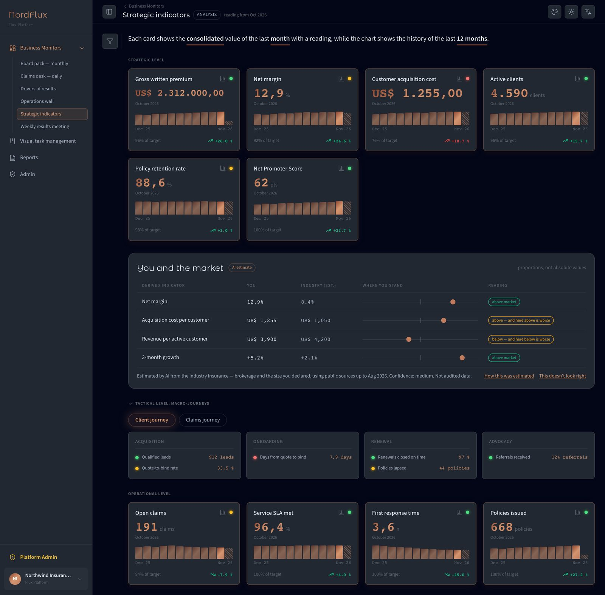
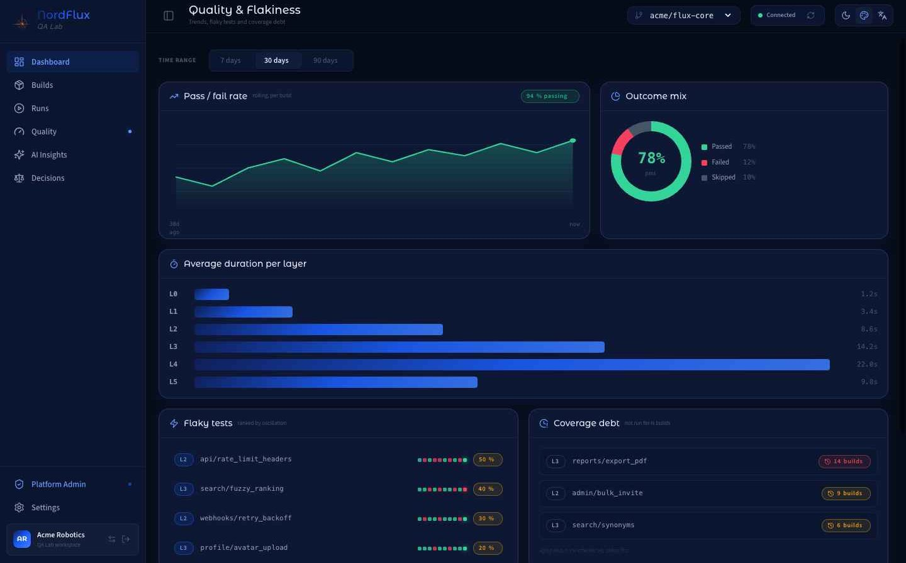
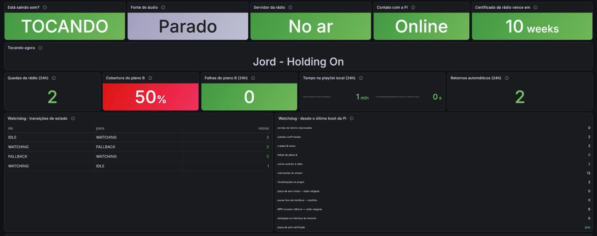
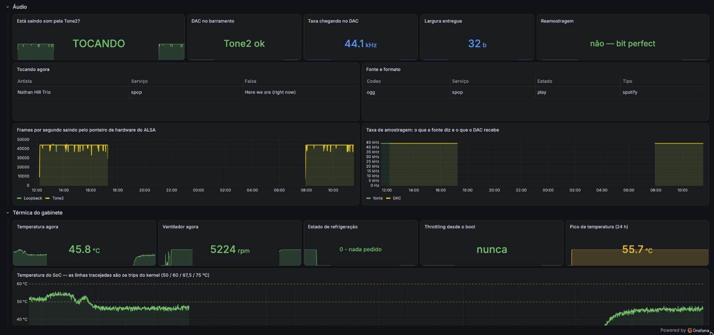
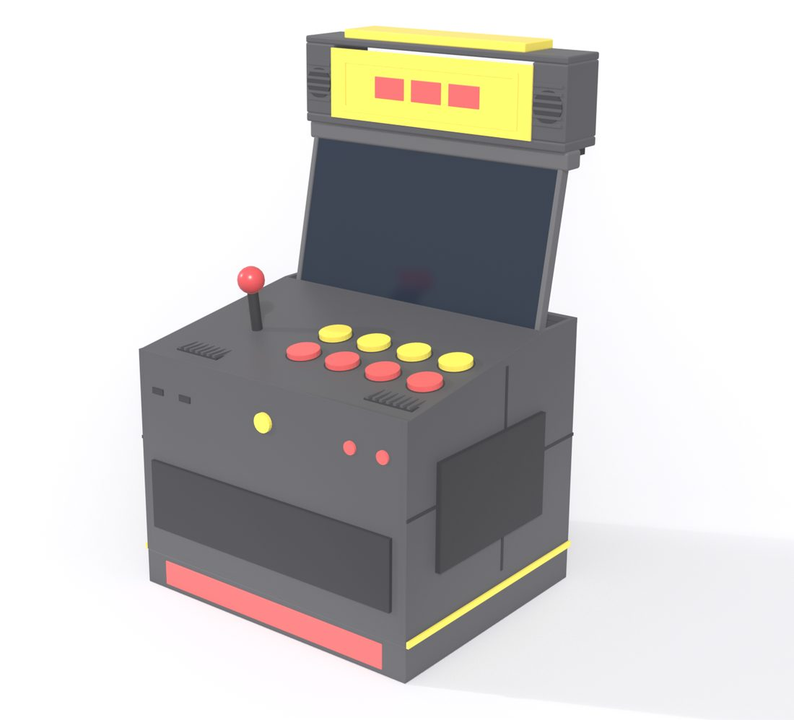
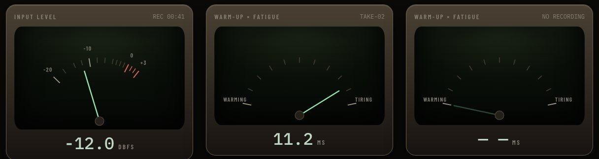
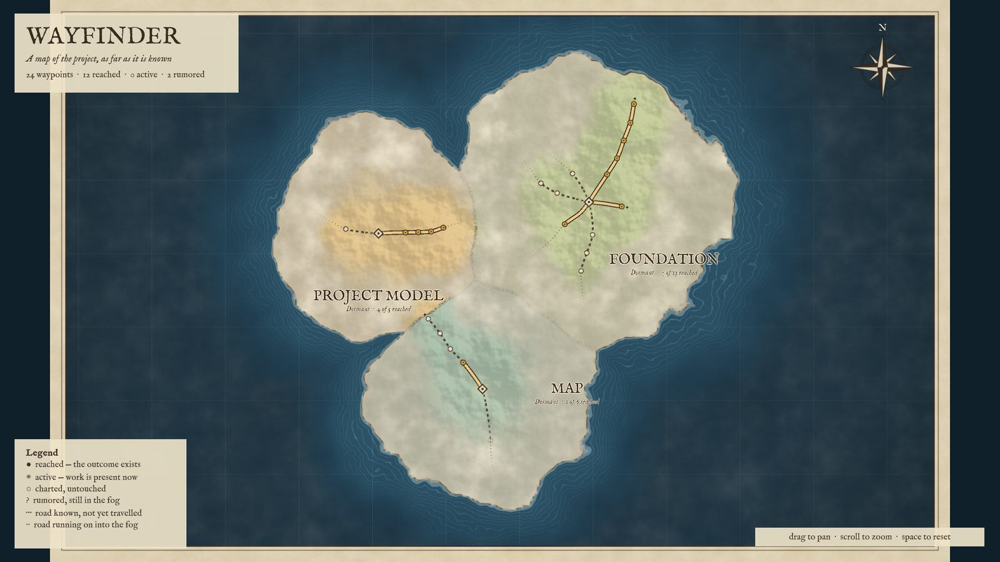

# Jose Mathias Gusso

**Curious enough to build it. Careful enough to prove it.**

I build things to find out how they work. This page shows what I am building now, what I'm learning and discovering and a hint of things that I love. The full write-up, with more pictures and architecture diagrams, is at **[mathias.nordflux.co](https://mathias.nordflux.co/github)**.

The code is private, for client and partner reasons. I am glad to walk through any of it live: jose.mathiasg@gmail.com · [LinkedIn](https://www.linkedin.com/in/mathiasgusso)

---

### Flux — indicators and the decisions based on them

A multi-tenant platform for managing company indicators and the decisions based on them. *NordFlux product. Deployed, the most mature of these.*

Indicators at strategic, tactical and operational levels, shown in four monitor views, with an operational task board configurable per workspace and reports built from board data and edited through chat. Data comes in through file import, a readings API, metric events or manual entry, all in the same readings format. React 19, Vite 7, Tailwind 4, TanStack Query; Node.js and Express; Neon PostgreSQL; Clerk; Anthropic API; Cloudflare Workers and Fly.io. Layers L0 and L1 run in CI through QA Lab: unit tests, back-end integration tests against a real PostgreSQL database, and front-end tests with a mocked API. A deploy runs only after they pass. *Image: names and data are fictional.*

### QA Lab — test observability platform

One place to follow every test run of a project, with its results, its evidence and the decisions made about it. *NordFlux product. In production since July 2026.*

Tests are organized in layers by speed and scope, and the fast ones gate every deploy. QA Lab collects the results of each run, whatever tool produced them, in one format and keeps them with their evidence: failure messages, logs and durations. Failed tests go to a triage screen with an AI summary on request, and every human call, such as a waiver, is recorded as a decision. An AI setup assistant diagnoses the first failed build of a newly connected repository. Flux is the first project using it. React 19, Node.js and Express, Neon PostgreSQL, Cloudflare R2, Clerk, Anthropic API. QA Lab runs its own tests: L0 and L1 in CI on both the front end and the back end. Live at [qa.nordflux.co](https://qa.nordflux.co) (sign-in required). *Image: the flaky-test and coverage-gap panels are still placeholders; data is fictional.*

### Radio watchdog — IoT, running in a store

A device and monitoring system that keeps a store's web radio playing. *Running in the field.*

If the stream stops or the output goes silent, the device restarts the stream, then switches to a local playlist until the stream returns. Silence is detected from the sound card and the player's log, not only from the player's status. Two separate probes show whether an outage came from the radio server or the network, and a test script stops the monitoring collectors on purpose to confirm the dashboard reports it. Raspberry Pi 3B, Volumio 4 with a Node.js plugin, Prometheus, Grafana and the blackbox exporter, over Tailscale.

### Hi-fi streamer — Raspberry Pi 5

A network music streamer for the living room. *Personal hardware project. In daily use.*

A Khadas Tone2 DAC and a 7-inch touch screen, in a 3D-printed enclosure modified to fit them; Volumio 4 with Spotify Connect. The sample rate from the source is compared with the rate the DAC receives, to confirm the audio is not resampled, and metrics are written to RAM only, so the SD card receives no writes. The radio watchdog's monitoring started on this device.

### Agent tooling
Plugins and skills for working with AI agents in Claude Code. *In daily use.*

Five skills for the Flux data import (flatten ClickUp exports, remove empty columns, define what a pipeline reports, standardise dimension values, send the metrics to Flux); the Woodshed tutor plugin; a skill that drafts LinkedIn posts about the products; and a rules file in each repository that tells the agent where to find information, which rules apply and how to test its changes. Agent output is accepted only after tests, schema checks or screenshots.

### Portable arcade — hardware and firmware

A tabletop arcade with a motorised screen lift and a fully 3D-printed case. *Personal hardware project. Screen lift tested on the bench.*

The 14-inch screen rises from a slot in the top of the case on a NEMA 17 stepper and a self-locking TR8 lead screw, with a TMC2209 driver and limit switches. Parts are modelled in Blender with Python scripts and checked for collisions with the screen open and closed before printing. Raspberry Pi 4 with Batocera; Raspberry Pi Pico with MicroPython.

### Woodshed — a music-learning app with an AI tutor

An app with an AI tutor that measures practice recordings. *Personal product. Tutor in use, app in design.*

The tutor runs as a Claude plugin. It conducts lessons and analyses recordings for timing, pitch and dynamics, note by note (Python, librosa, NumPy). If more than 10% of the expected notes are missing, the recording is not used, and values in lesson records are written by a script, not typed by the AI. The app is in design, with an interface modelled on instrument panels. Bass is the first supported instrument.

### Wayfinder — a project drawn as an explorable map

A roadmap tool that shows a project as an explorable map. *Personal product. Throwaway prototype; the planned SDK and clients are not built yet.*

Project domains appear as regions and work tracks as roads; areas not yet explored are covered by fog. The terrain, fog, icons and compass are generated in code. A C++20 parser (CMake, Ninja, CTest) generates map files validated against a JSON Schema, and a Unity 6.3 prototype renders them; the build runs without a window and saves a screenshot for visual review. Planned: a C++ SDK, Unity and Unreal Engine 5 clients, Go and Java services.

---

Before this: firmware project manager and QA lead at HP, where I introduced Continuous Integration to the firmware organisation; Principal QA and Lead Iteration Manager at ThoughtWorks; delivery and transformation work in Sydney and at Sicredi.
