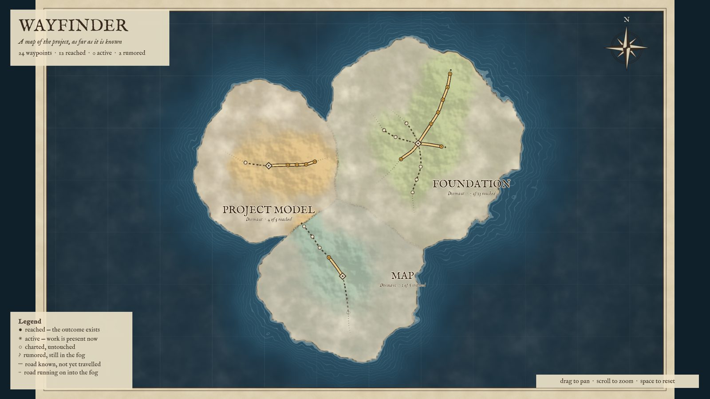
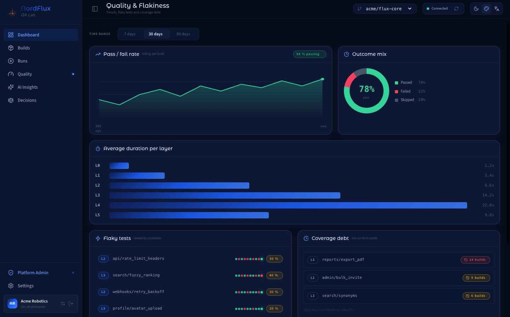
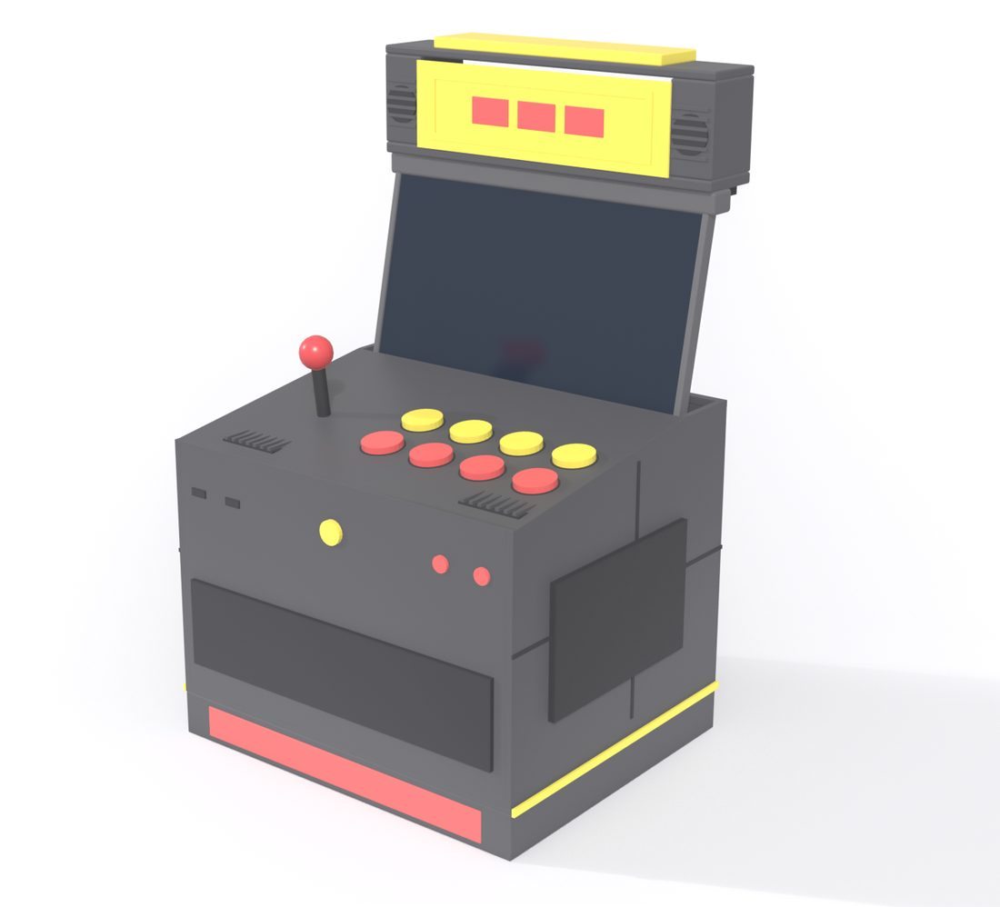

# Jose Mathias Gusso

Quality engineering, delivery and hands-on software, for twenty years. Based in Porto Alegre, Brazil (UTC−3), open to relocation.

Most of my code lives in private repositories, for client and partner reasons. This page shows what is in them; the full write-up, with more pictures, is at **[mathias.nordflux.co](https://mathias.nordflux.co/github)**. Happy to walk through any of it on a call: jose.mathiasg@gmail.com · [LinkedIn](https://www.linkedin.com/in/mathiasgusso)

---

### Wayfinder — a project drawn as an open world

Working prototype. A C++20 core holds the model and its rules (CMake, Ninja, CTest with JSON Schema contract checks); a Unity 6.3 client renders terrain, fog and icons in code, builds headless and captures its own screenshots for visual checks. Unreal Engine 5, Go and Java toolchains are set up for the clients and services that come next.

### QA Lab — test observability platform

Tool-agnostic, multi-tenant. Runs the test layers a repository declares (L0 unit, L1 integration with mocks, L2 real integration, L3 end-to-end in a browser, L4 non-functional, L5 manual) and gates deploys on the fast ones, L0 and L1, which are the layers running today. Normalises every result into one contract, keeps its evidence, and records human decisions such as waivers; failed runs get an AI summary on request. Node.js, Express, PostgreSQL, S3 and R2, React 19. Live at [qa.nordflux.co](https://qa.nordflux.co). *Image: hi-fi prototype, fictional data.*

### Flux — decision intelligence platform
Multi-tenant governance of a company's indicators: versioned formulas, an ingestion pipeline with CSV and API connectors, and views for the operations panel, the results meeting and a causal map. Express and PostgreSQL, React 19; L0 unit and L1 integration tests against a real database, deploys gated on CI.

### Woodshed — a music-learning app tutored by AI
The tutor already works as a Claude plugin: one skill conducts lessons with a memory of previous sessions, another turns a recording into timing, pitch and dynamics data, note by note. The app is in design, with an instrument-panel visual language where every value on screen is measured and says so.

### Radio watchdog and telemetry — IoT, running in a store
A Volumio 4 plugin that keeps a store's web radio playing, falling back to a local playlist and resuming the stream on its own. Silence is measured at the sound card, not taken from the player's status. A Prometheus and Grafana stack with blackbox probes shows whether sound is coming out and whose fault it was when it was not.

### Hi-fi streamer — Raspberry Pi 5, Khadas Tone2, 7-inch touch screen
A living-room network streamer in a 3D-printed enclosure, with its own telemetry: it compares the rate the source reports with the rate the DAC receives, so resampling shows up on a dashboard. It is where the radio watchdog's telemetry was born.

### Portable modular arcade — hardware and firmware

Emulation on a Raspberry Pi 4; the 14-inch screen rises on a motorised lift (NEMA 17, self-locking TR8 lead screw) run by a Raspberry Pi Pico in MicroPython. Every part is designed in Blender from Python scripts and checked for interference across the lift's full travel before printing; the lift passed a 0.3 mm bench test before the case existed.

### Agent tooling
Claude Code is my main development environment. I build Claude plugins, agent skills and MCP integrations for delivery work (Git ↔ ClickUp sync, product memory, proposals and contracts), and a contract file in each repository that tells the agent where facts live and how to verify its own changes.

---

Before this: firmware project manager and QA lead at HP (introduced Continuous Integration to the firmware organisation), Principal QA and Lead Iteration Manager at ThoughtWorks, delivery and transformation work in Sydney and at Sicredi.
